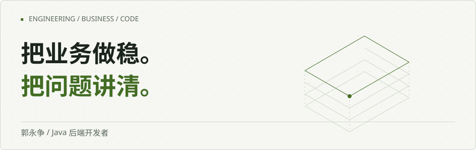
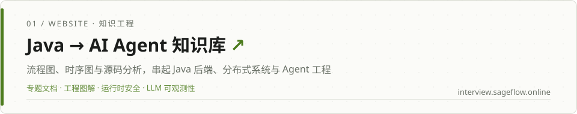
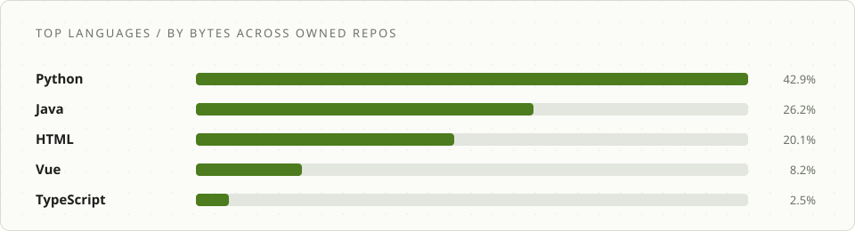
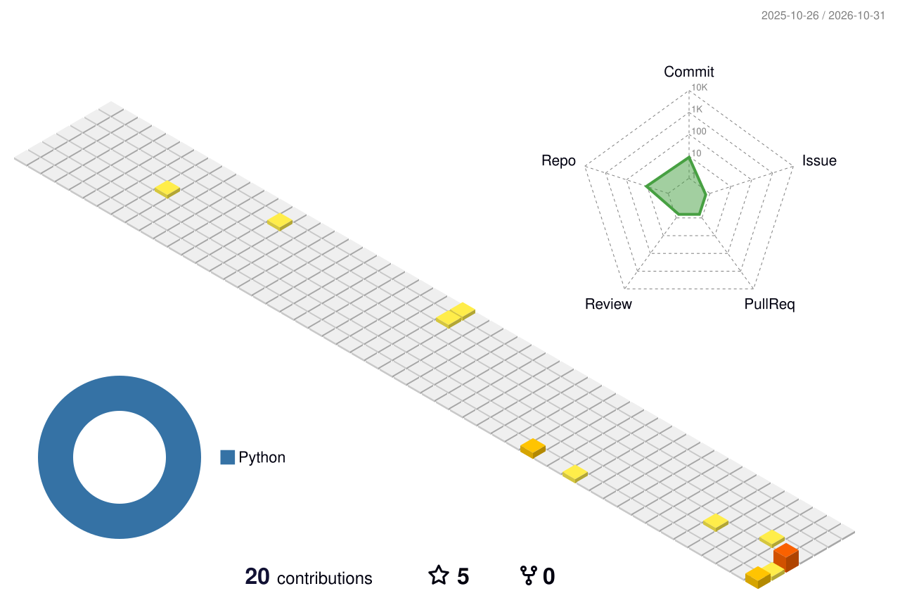

<picture>
  <source media="(prefers-color-scheme: dark)" srcset="assets/banner-dark.svg" />
  
</picture>

<picture>
  <source media="(prefers-color-scheme: dark)" srcset="assets/roles-dark.svg" />
  
</picture>

<picture>
  <source media="(prefers-color-scheme: dark)" srcset="https://readme-typing-svg.demolab.com?font=Segoe+UI&weight=600&size=22&duration=3000&pause=1200&center=false&vCenter=true&width=640&height=60&lines=%E6%8A%8A%E4%B8%9A%E5%8A%A1%E5%81%9A%E7%A8%B3%E3%80%82%E6%8A%8A%E9%97%AE%E9%A2%98%E8%AE%B2%E6%B8%85%E3%80%82&lines=%E6%94%AF%E4%BB%98%20%C2%B7%20%E6%B8%85%E7%BB%93%E7%AE%97%20%C2%B7%20%E7%94%B5%E5%AD%90%E7%AD%BE%E7%BA%A6%20%C2%B7%20%E8%B4%A2%E7%A8%8E&lines=%E5%9C%A8%E7%94%9F%E4%BA%A7%E7%8E%AF%E5%A2%83%E9%87%8C%E9%AA%8C%E8%AF%81%20AI%20Ops&color=C2EF82" />
  
</picture>

> 8 年 Java 后端 · 支付、清结算、电子签约、财税业务 · 别人演示 AI 能做什么，我证明 AI 在生产里怎么不出事、怎么算得清账
>
> 完整版工程主页：**[guozhengit.github.io/guozhengit](https://guozhengit.github.io/guozhengit/)**

## 成果与在线作品

<a href="https://interview.sageflow.online/#/doc/d30">
  <picture>
    <source media="(prefers-color-scheme: dark)" srcset="assets/work-interview-dark.svg" />
    
  </picture>
</a>

<a href="https://train.sageflow.online/">
  <picture>
    <source media="(prefers-color-scheme: dark)" srcset="assets/work-train-dark.svg" />
    
  </picture>
</a>

<a href="https://resume.sageflow.online/">
  <picture>
    <source media="(prefers-color-scheme: dark)" srcset="assets/work-resume-dark.svg" />
    
  </picture>
</a>

## 精选仓库

| 仓库 | 说明 |
|---|---|
| **[edgehotel-agent](https://github.com/guozhengit/edgehotel-agent)** | 端侧 Agent 运行时：8GB 显存消费级主机，数据不出本机、断网可用（Java 17 / Spring Boot 3.5） |
| **[ai-ops-portfolio](https://github.com/guozhengit/ai-ops-portfolio)** | AI 生产化实践：故障诊断、多模型路由、成本核算 |
| **[coordinate-picker](https://github.com/guozhengit/coordinate-picker)** | PDF 坐标精确拾取工具（TypeScript） |
| **[training-center](https://github.com/guozhengit/training-center)** | 面试训练中心服务端（Java） |

## My toolbox

**后端**       

**AI 工程**     

**工程化**     

## 业务关注点

<b>接口成功，不等于业务完成。</b>

请求受理、渠道处理成功、资金到账和对账完成，是不同的业务状态。设计接口时需要分别说明状态来源，以及超时、重试和重复通知时怎么处理。

<b>先说清边界，再谈怎么实现。</b>

跨系统协作先确定责任边界：谁发起请求，谁持有最终状态，重复调用如何识别，异常由谁处理。边界不清楚，增加重试次数也不能解决问题。

<b>问题要能沿着链路查回去。</b>

排查一笔异常时，需要把入口请求、业务单号、外部响应和状态变更放在同一条时间线上。记录应足够定位问题，也要避免把敏感数据直接写入日志。

## GitHub

<picture>
  <source media="(prefers-color-scheme: dark)" srcset="assets/stats-dark.svg" />
  
</picture>

<picture>
  <source media="(prefers-color-scheme: dark)" srcset="assets/langs-dark.svg" />
  
</picture>

<picture>
  <source media="(prefers-color-scheme: dark)" srcset="profile-3d-contrib/profile-night-rainbow.svg" />
  
</picture>

---

<samp>代码之外，还有业务。</samp>

<a href="https://guozhengit.github.io/guozhengit/">工程主页 ↗</a> · <a href="https://resume.sageflow.online/">在线简历 ↗</a>

